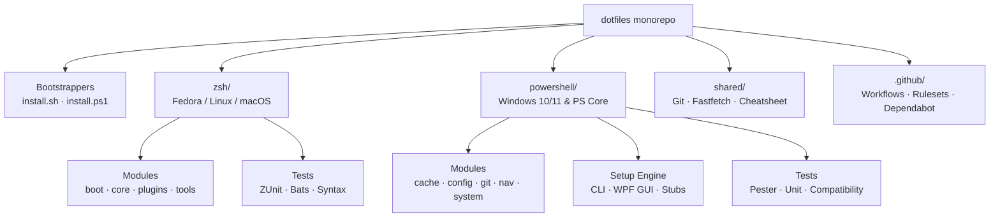

<div align="center">

<h1>dotfiles</h1>

<p><strong>Cross-platform, modular developer environments for Linux (Fedora-first), macOS, and Windows.</strong></p>

[](https://github.com/AndersonTavares0/dotfiles/actions/workflows/ci.yml)
[](LICENSE)
[](powershell/)
[](zsh/)
[](https://fedoraproject.org)
[](powershell/)

<p><a href="#overview">Overview</a> &middot; <a href="#quickstart">Quickstart</a> &middot; <a href="#architecture">Architecture</a> &middot; <a href="#shell-subsystems">Subsystems</a> &middot; <a href="#cross-shell-parity">Cross-Shell Parity</a> &middot; <a href="#governance-and-cicd">CI/CD &amp; Governance</a> &middot; <a href="#documentation">Documentation</a></p>

</div>

---

## Overview

This repository unifies and automates shell configurations across personal workstations running Fedora Linux, macOS, and Windows 10/11. Built as an isolated monorepo, it maintains distinct configuration trees for Zsh and PowerShell 7+ while providing shared tool conventions, resilient bootstrappers, and automated quality gates.

### Core Guarantees

- **Zero Elevation Linking:** Installs into user-scoped paths without requiring root privileges or administrative UAC elevation.
- **Fast Startup:** Sub-100ms boot target achieved through bytecode compilation, instant prompt loading, and version-fingerprinted caching.
- **In-Shell Security:** Proactive history redaction for secrets, tokens, API keys, and sensitive CLI arguments, complemented by execution guards for destructive system commands.
- **Strict Isolation:** Modular architecture separating boot sequences, core options, tool definitions, and theme rendering.
- **Reproducible Verification:** Automated testing across four operating system environments (Ubuntu, macOS, Windows Server 2022, Windows Server 2025).

---

## Quickstart

### Linux and macOS (Zsh)

Execute the remote bootstrap in an interactive terminal session:

```bash
curl -fsSL https://raw.githubusercontent.com/AndersonTavares0/dotfiles/main/install.sh | bash
```

Or install non-interactively in automation scripts:

```bash
./install.sh --install
```

### Windows (PowerShell 7)

Execute the remote bootstrapper in a PowerShell 5.1+ or PowerShell 7 session:

```powershell
irm https://raw.githubusercontent.com/AndersonTavares0/dotfiles/main/install.ps1 | iex
```

Or run the setup launcher locally with optional graphical interface:

```powershell
.\install.ps1 -Gui
```

---

## Architecture

The monorepo organizes platform concerns into independent subtrees while sharing root-level bootstrappers, CI/CD orchestration, and common configuration assets.



### Directory Layout

```text
dotfiles/
|-- install.sh                  # Universal POSIX bootstrapper
|-- install.ps1                 # Universal Windows bootstrapper
|-- check.sh                    # Local pre-commit quality check harness
|
|-- zsh/                        # Zsh environment
|   |-- .zshrc                  # Entrypoint profile
|   |-- .p10k.zsh               # Powerlevel10k theme definition
|   |-- install.sh              # Subsystem installer
|   |-- modules/                # Modular config components
|   |   |-- boot/               # Instant prompt, timer, theme, compilation
|   |   |-- core/               # Environment paths, shell options, security
|   |   |-- plugins/            # Fingerprinted init cache, Oh My Zsh, lazy loading
|   |   `-- tools/              # Aliases, functions, local overrides, NVIDIA helpers
|   `-- tests/                  # ZUnit specifications, Bats suites, and runner
|
|-- powershell/                 # PowerShell 7+ environment
|   |-- Microsoft.PowerShell_profile.ps1 # Profile entrypoint
|   |-- setup.ps1               # PowerShell profile installer
|   |-- modules/                # Functional modules (cache, config, git, nav, system)
|   |-- setup/                  # Installer modules (agent-clis, deps, gui, profile)
|   |-- themes/                 # Oh My Posh themes
|   `-- tests/                  # Pester suites, Unit tests, and regression harnesses
|
|-- shared/                     # Shared configurations
|   |-- git/.gitconfig          # Base Git identity, diff, and alias defaults
|   `-- fastfetch/config.jsonc  # System info display configuration
|
`-- docs/                       # Monorepo technical documentation
    `-- cross-shell-cheatsheet.md # Command equivalence dictionary
```

---

## Shell Subsystems

### Zsh Profile (Linux & macOS)

- **Startup Chain:** Enforces deterministic initialization order. Powerlevel10k instant prompt is sourced first to eliminate perceived latency, followed by wall-clock timers and environment variables.
- **Plugin Fingerprint Cache:** Third-party tool initializations (`zoxide`, `fzf`) are cached to `$XDG_CACHE_HOME/zsh_plugins_init.zsh`. Cache validity is derived from binary version hashes rather than filesystem timestamps, avoiding redundant command spawns during startup.
- **History Credential Filter:** The `zshaddhistory` hook parses commands in real-time, preventing persistence of assignments matching tokens, secrets, private keys, API keys, AWS credentials, and arbitrary payloads exceeding 4096 characters.
- **Sudo Interceptor:** The `sudo-last` utility previews the preceding command from history, requiring explicit confirmation and blocking known dangerous invocations (`rm -rf /`, `mkfs`, `dd of=`, `chmod -R 777 /`).
- **NVIDIA and Fedora Diagnostics:** Integrated helpers for GPU state (`gpu-status`), Akmods kernel module verification (`akmods-status`), and CUDA environment activation (`cuda-on`, `cuda-off`).

### PowerShell 7 Profile (Windows)

- **Strict Mode Enforcement:** All profile scripts execute under `Set-StrictMode -Version Latest` with terminating errors during initialization, restoring user preferences upon interactive shell availability.
- **TTL Cache Architecture:** Implements a 24-hour TTL cache for Oh My Posh prompt rendering and Zoxide navigation. Hot-path startup validates the cache fingerprint in approximately 5ms without invoking `Get-Command` or recalculating full file hashes.
- **Managed Profile Block:** Profile installation maintains a clearly marked block within `$PROFILE.CurrentUserAllHosts`, preserving surrounding user configurations. Supports backward compatibility and seamless migration from legacy stubs.
- **Installer Interfaces:** Supports non-interactive automation flags, an interactive terminal menu, and a full WPF graphical installer for component selection and font installation.

---

## Cross-Shell Parity

Common workflows map consistently across both environments:

| Workflow Category | Linux / macOS (Zsh) | Windows (PowerShell 7) | Behavior |
|---|---|---|---|
| Startup Performance | `zshrc-time` | Startup banner / `benchmark.ps1` | Displays measured boot latency in milliseconds |
| Directory Jump | `dtop` | `dtop` | Resolves platform Desktop path |
| Parent Directory | `up [n]` | `up [n]` | Traverses up `n` directory levels |
| Directory Scaffolding | `mkcd <dir>` | `mkcd <dir>` | Creates directory structure and navigates into it |
| Fast Commit | `gcom "<msg>"` | `gcmt "<msg>"` | Stages tracked changes and commits with message |
| Network Ports | `port [num]` | `ports [num]` | Inspects listening TCP/UDP network sockets |
| Safe Backup | `bk <file>` | `bk <file>` | Generates a timestamped `.bak.YYYYMMDD_HHMMSS` copy |
| Icon Directory Listing | `ls`, `ll`, `la` (`eza`) | `ls`, `ll`, `la` (`eza` / `Terminal-Icons`) | Lists directory contents with Nerd Font file glyphs |

Detailed command mappings and function parameters are cataloged in the [Cross-Shell Cheatsheet](docs/cross-shell-cheatsheet.md).

---

## Governance and CI/CD

### Repository Ruleset

The repository enforces branch integrity on `main` via modern GitHub Repository Rulesets (`main-protection`):

- **Deletion & Modification:** Deletion of `main` is blocked; non-fast-forward (force push) operations are prohibited.
- **Linear History:** All pull requests require squash merging or rebase merging to maintain a clean Git history.
- **Pull Request Workflow:** Direct pushes are prevented; merges require pull request creation, resolution of all conversation threads, and passing status checks.
- **Autonomous Review:** Configured with `required_approving_review_count: 0` to enable automated personal workflow validation while enforcing status checks before merge.
- **Emergency Bypass:** The repository administrator retains explicit override permissions for maintenance emergencies.

### Unified CI Gate

To avoid status check deadlocks common in multi-OS monorepos, the pipeline uses a dynamic path-filtering model:

1. **Path Detection:** Job `changes` inspects modified files (`zsh/**`, `powershell/**`, `docs/**`).
2. **Selective Execution:** Jobs for Linux/macOS and Windows 2022/2025 runners execute only when corresponding subtrees are touched.
3. **CI Gate Aggregator:** Job `ci-gate` evaluates the collective execution status, verifying that required jobs succeeded and untouched platforms were safely bypassed. `ci-gate` serves as the sole required check in the repository ruleset.

### Automated Maintenance

- **Dependabot:** Scans GitHub Actions dependencies on a weekly schedule.
- **Release Pipeline:** Pushing version tags (`v*`) triggers automated packaging of release archives (`.tar.gz`, `.zip`) with generated release notes.
- **Local Validation:** The `./check.sh` utility executes syntax validation, ShellCheck, ZUnit, and Bats suites prior to pushing commits.

---

## Testing

Execute the local verification test suites:

```bash
# Full local test harness (Syntax, ZUnit, Bats, Git hygiene)
./check.sh

# Zsh test suite standalone
./zsh/tests/run.sh

# PowerShell test suite standalone (Windows / pwsh)
pwsh -File powershell/tests/Unit.Tests.ps1 -Verbose
```

---

## Documentation

- [Cross-Shell Command Equivalence](docs/cross-shell-cheatsheet.md)
- [Zsh Architecture and Engineering Reference](zsh/docs/TECHNICAL.md)
- [PowerShell Modules Technical Reference](powershell/docs/modules.md)
- [PowerShell Windows Compatibility Audit](powershell/docs/auditoria-windows.md)
- [PowerShell Installation and Troubleshooting Guide](powershell/docs/installation.md)
- [Engineering Guidelines for AI Agents](AGENTS.md)

---

## License

This project is open source and available under the [MIT License](LICENSE).
